<p align="center">
  <picture>
    <source media="(prefers-color-scheme: dark)" srcset="custom_components/goxlr_control/brand/dark_logo@2x.png">
    
  </picture>
</p>

<p align="center">
  Control your GoXLR or GoXLR Mini from Home Assistant, reliably.<br>
  <a href="https://github.com/MineMax6543/ha-goxlr-control/releases"></a>
  <a href="https://hacs.xyz"></a>
</p>

---



- **Instant:** the [GoXLR Utility](https://github.com/GoXLR-on-Linux/goxlr-utility) tells Home
  Assistant about every fader move, mute and button press the moment it happens. Nothing is polled.
- **Stable:** keeps working after days of uptime, PC sleep and Utility restarts, and reconnects
  on its own.
- **Made for automations:** an on-air light while you talk, GoXLR buttons that run scenes, the
  mic muted when the doorbell rings.

## Install

1. **Settings → Marketplace → Add from link** → `MineMax6543/ha-goxlr-control`
2. Install **GoXLR Control Plus** and restart Home Assistant.
3. **Settings → Devices & services → Add integration → GoXLR Control Plus.**

## Connect

| | |
|---|---|
| **On the PC** | GoXLR Utility settings → turn on **Allow Network Access**, restart the Utility, and allow TCP port **14564** through the firewall. |
| **In Home Assistant** | Enter the PC's IP address and port `14564`. Give the PC a fixed IP in your router; if it changes, use **⋮ → Reconfigure**. |

## What you get

| | |
|---|---|
| 🎚️ **Mixing** | volume of every channel, fader mutes, mic mute, fader assignments, Mix B, routing |
| 🎙️ **Microphone** | mic type and gain, noise gate, compressor, de-esser, EQ, profiles |
| ✨ **Effects** | on/off, presets, reverb, echo, pitch, gender, megaphone, robot, hard tune |
| ▶️ **Sampler** | bank, play/stop each pad, "is playing" sensors |
| 💡 **Lighting** | the whole device as one RGB light, animations, fader screen text |
| 🔘 **Buttons** | every physical button as an event: pressed, short press, long press, released |
| 🗣️ **Speaking** | optional "you're talking" sensor for an on-air light |
| 🖥️ **Utility** | connection status, auto reconnect, start on login, firmware update notice |

Works with the GoXLR and the GoXLR Mini. Fine-tuning controls (routing matrix, EQ bands,
effect details, …) are hidden until you switch them on under **Configure**.

## Examples

**On-air light:** a light turns red while you talk. Needs **Mic level monitoring** switched on.

```yaml
triggers:
  - trigger: state
    entity_id: binary_sensor.goxlr_speaking
actions:
  - if: "{{ trigger.to_state.state == 'on' }}"
    then:
      - action: light.turn_on
        target: { entity_id: light.office_door }
        data: { color_name: red }
    else:
      - action: light.turn_off
        target: { entity_id: light.office_door }
```

**Doorbell mutes the mic:**

```yaml
triggers:
  - trigger: state
    entity_id: binary_sensor.doorbell
    to: "on"
actions:
  - action: switch.turn_on
    target:
      entity_id: switch.goxlr_mic_mute
```

## Staying connected



If the PC's power is cut while it's off, turn **Auto reconnect** off to stop retrying, or let
a smart plug do it ([example](docs/reference.md#staying-connected)).

## Something wrong?

**GoXLR Control Plus → ⋮ → Download diagnostics** and attach the file to an
[issue](https://github.com/MineMax6543/ha-goxlr-control/issues). It contains the connection
state and what the Utility reported.

---

All entities, advanced controls, raw commands and troubleshooting:
**[docs/reference.md](docs/reference.md)**

<sub>Not affiliated with TC-Helicon. GoXLR is a trademark of its owner.</sub>
