# GoXLR Control Plus reference

Everything in detail. For a quick start see the [README](../README.md).

- [Setup](#setup)
- [What you can control](#what-you-can-control)
- [Advanced controls](#advanced-controls)
- [Staying connected](#staying-connected)
- [Speaking sensor](#speaking-sensor)
- [Buttons](#buttons)
- [Lighting](#lighting)
- [Raw commands](#raw-commands)
- [What's deliberately left out](#whats-deliberately-left-out)
- [Troubleshooting](#troubleshooting)
- [Development](#development)

## Setup

1. **On the PC:** in the GoXLR Utility settings, turn on **Allow Network Access** and restart
   the Utility. Allow TCP port **14564** through the firewall.
2. **In Home Assistant:** *Settings → Devices & services → Add integration → GoXLR Control
   Plus*, then enter the PC's IP address and port `14564`.

Give the PC a fixed IP address in your router. If the IP changes later, use **⋮ →
Reconfigure** on the integration.

The Utility receives commands over HTTP and pushes every change over a WebSocket; the GoXLR
itself is connected to the PC by USB.

## What you can control

| Area | |
|---|---|
| 🎚️ **Mixing** | Volume of every channel, fader mutes, mic mute, fader assignments, mute targets, Mix B, headphone mix, routing |
| 🎙️ **Microphone** | Mic type and gain, noise gate, compressor, de-esser, EQ, profiles |
| ✨ **Effects** | On/off, presets, and style and amount for reverb, echo, pitch, gender, megaphone, robot, hard tune |
| ▶️ **Sampler** | Bank, play/stop each pad, "is playing" sensors |
| 💡 **Lighting** | The whole device as one RGB light, animations, fader screen text |
| 🔘 **Buttons** | Every physical button triggers automations: `pressed`, `short_press`, `long_press`, `released` |
| 🗣️ **Speaking** | Optional "you're talking" sensor, ideal for an on-air light |
| 🖥️ **Utility** | Connection status, auto reconnect, start on login, open the Utility window, firmware update notice |

The full-size GoXLR gets about 300 entities. The Mini gets only the ones it supports.

## Advanced controls

Fine-tuning controls are hidden until you want them. Switch them on a group at a time under
**Settings → Devices & services → GoXLR Control Plus → Configure**:

| Group | Adds |
|---|---|
| Routing matrix | One switch per input → output route |
| Mix B details | Per-channel Mix B volumes and links (only work while **Mix B** is on) |
| Mic EQ | Gain and frequency per band |
| Noise gate & compressor timing | Attack and release |
| Effect fine-tuning | Reverb decay, echo delays, robot bands, … |
| Fader screen extras | Screen number, icon, invert |
| Sampler pad settings | Playback mode and order per pad |
| Lighting details | Animation modifiers, fader light styles |
| Other rarely used | Mic level sensor, VOD mode, log level, … |

## Staying connected



- A heartbeat catches connections that died silently, and a full resync repairs anything that
  was missed.
- If the PC is off, controls show as *unavailable* and come back on their own when it's on
  again.
- If the PC's power is cut when it's off, turn **Auto reconnect** off to stop retrying.
  Turning it on reconnects immediately. You can tie it to a smart plug:

```yaml
automation:
  - alias: GoXLR follows PC power
    triggers:
      - trigger: state
        entity_id: switch.pc_power_plug
        to: ["on", "off"]
    actions:
      - action: "switch.turn_{{ trigger.to_state.state }}"
        target:
          entity_id: switch.goxlr_utility_auto_reconnect
```

## Speaking sensor

Turn on **Mic level monitoring** to get **Speaking**. It turns on when you go above the
**Speaking threshold** (default −40 dBFS) and stays on for 1 second after you go quiet.
Nothing is polled while monitoring is off.

## Buttons

Every physical button is an event entity with the event types `pressed`, `short_press`,
`long_press` and `released`:

```yaml
triggers:
  - trigger: state
    entity_id: event.goxlr_sampler_clear_button
    attribute: event_type
    to: short_press
```

A long press fires after the GoXLR's mute hold time (500 ms by default). The buttons still do
their normal job on the GoXLR.

**Mic mute says "Hold mode":** the GoXLR's mute button can be set to *hold* to mute. Set
**Mic mute button mode** to *Toggle* to control it from Home Assistant.

## Lighting

Pick a colour to colour the whole device. **Off** turns the LEDs black. **On** brings back the
colour you last set from Home Assistant, or otherwise your profile's *saved* colours.

## Raw commands

`goxlr_control.send_command` and `goxlr_control.send_utility_command` can send any
[GoXLR Utility command](https://github.com/GoXLR-on-Linux/goxlr-utility/blob/main/ipc/src/lib.rs):

```yaml
action: goxlr_control.send_command
data:
  device_id: <your GoXLR>
  command: {"SetFaderColours": ["A", "FF0000", "000000"]}
```

## What's deliberately left out

- **Allow network access:** turning it off would lock Home Assistant out.
- **Stop Utility:** it can't be started again remotely.
- **Firmware install:** an interrupted update can brick the GoXLR. You get a notice when an
  update is available, and you install it from the Utility.
- **Deleting profiles:** too destructive for a one-click control. It's still possible with
  `send_command`.

## Troubleshooting

| Problem | Fix |
|---|---|
| "Could not reach the GoXLR Utility" | Check that **Allow Network Access** is on, port 14564 is open, and the IP is right. `http://<PC-IP>:14564` should open the Utility in a browser. |
| Integration not listed | Restart Home Assistant fully and hard-refresh the browser |
| Mix B controls unavailable | Turn on the **Mix B (submix)** switch |

## Development

```sh
pip install pytest-homeassistant-custom-component
pytest
```

The tests run the integration inside a real Home Assistant instance against a fake GoXLR
Utility.
